# NeuroLearn AI

**One curriculum, three adaptive learning engines.** NeuroLearn AI is an interactive front-end prototype that takes a school chapter and presents it in formats designed for students with **ADHD**, **autism (ASD)** and **dyslexia**, alongside the teacher and district-admin views of the same product.


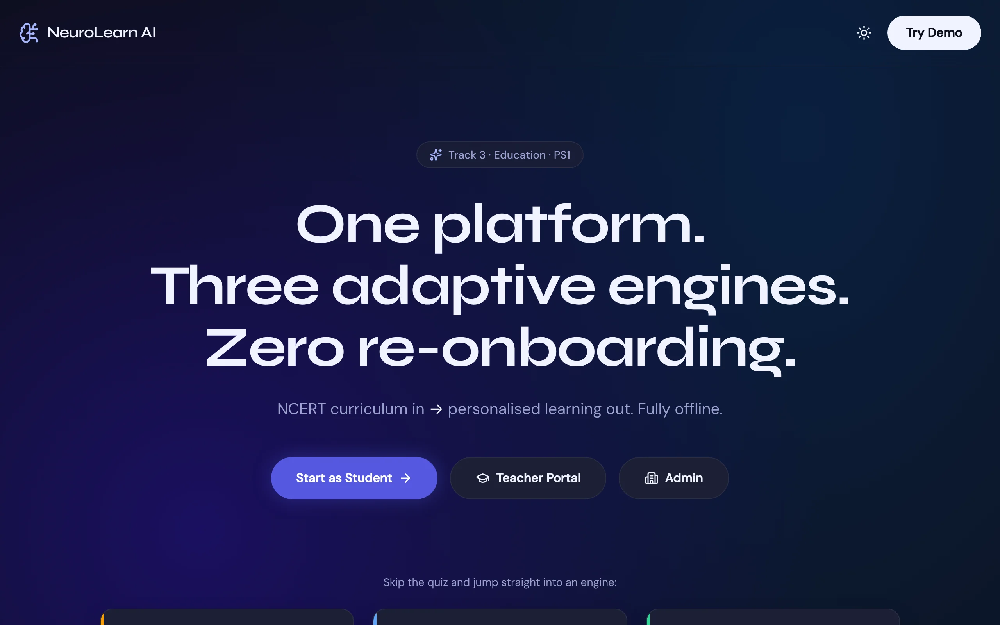

---

## Contents

- [Overview](#overview)
- [Screenshots](#screenshots)
- [Features](#features)
- [Tech stack](#tech-stack)
- [Architecture](#architecture)
- [Project structure](#project-structure)
- [Getting started](#getting-started)
- [Configuration](#configuration)
- [Usage walkthrough](#usage-walkthrough)
- [Scripts](#scripts)
- [Routes](#routes)
- [Design system and theming](#design-system-and-theming)
- [Accessibility](#accessibility)
- [Testing](#testing)
- [Linting and formatting](#linting-and-formatting)
- [Deployment](#deployment)
- [Troubleshooting and FAQ](#troubleshooting-and-faq)
- [Known limitations](#known-limitations)
- [Roadmap ideas](#roadmap-ideas)
- [Contributing](#contributing)
- [License](#license)

## Overview

### The problem

In most classrooms a chapter is written once, for one kind of reader. Students with ADHD, autism or dyslexia often get the same dense text as everyone else, and adapting it by hand is slow work that teachers rarely have time for.

### The idea

NeuroLearn AI explores a platform where:

1. a **teacher** uploads a chapter once,
2. the platform produces three adapted versions (action-driven for ADHD, calm and literal for ASD, audio-first for dyslexia), and
3. each **student** gets the version that suits them, chosen by a short onboarding quiz, without having to re-onboard for every subject.
4. A **district admin** can watch rollout and engagement across schools.

### What this repository is

This is a **clickable prototype** of that journey, built so hackathon judges and other stakeholders can try it in a browser. It runs entirely on the client: lesson content, the "AI" pipeline and the district metrics are bundled sample data and simulations. There is no backend, no model call and no network request at runtime. See [Known limitations](#known-limitations).

**Who it's for:** educators, product and design teams, and judges evaluating the concept; developers who want a starting point for an inclusive-learning UI.

## Screenshots

All screenshots were captured from the running app with its built-in sample data.

| Student dashboard                                                                       | Onboarding quiz                                                |
| --------------------------------------------------------------------------------------- | -------------------------------------------------------------- |
| 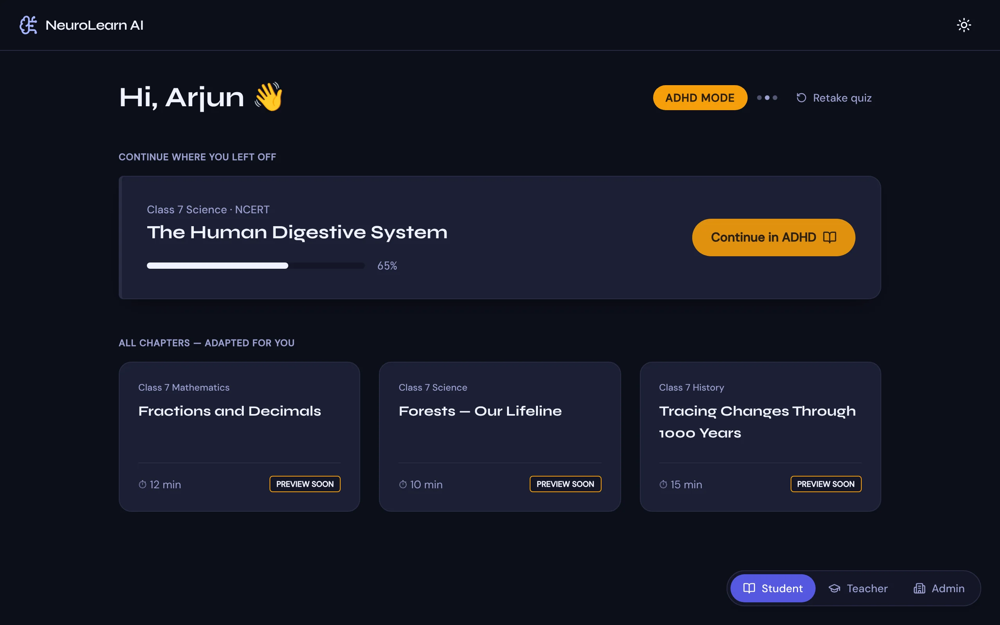 | 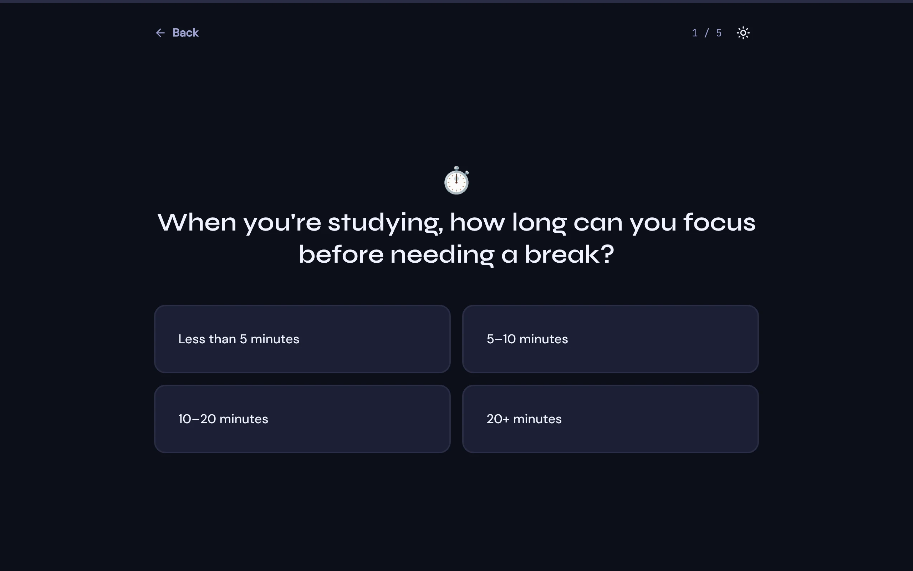 |

| ADHD engine                                                                                             | ASD engine                                                                               |
| ------------------------------------------------------------------------------------------------------- | ---------------------------------------------------------------------------------------- |
| 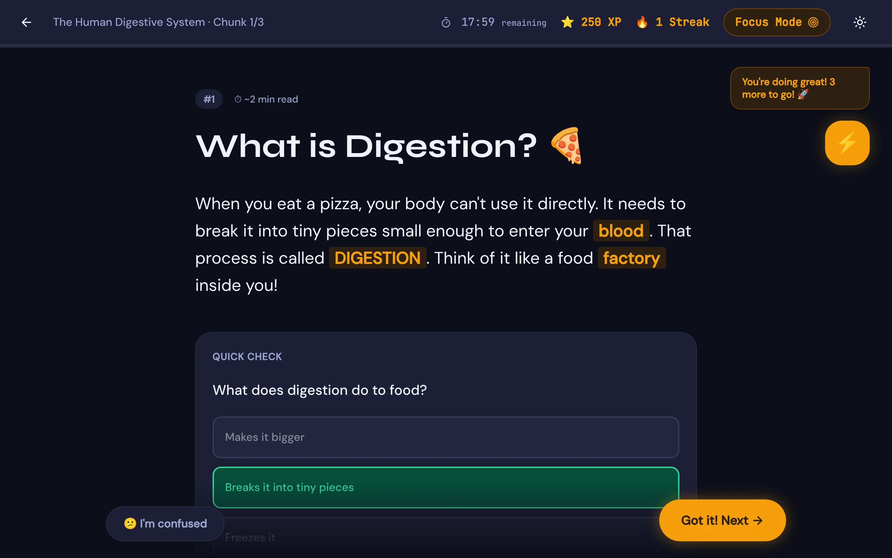 | 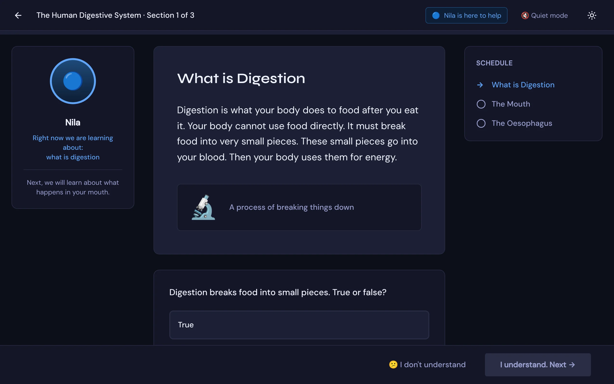 |

| Dyslexia engine (syllable view)                                                             | Dyslexia engine (light theme)                                                      |
| ------------------------------------------------------------------------------------------- | ---------------------------------------------------------------------------------- |
| 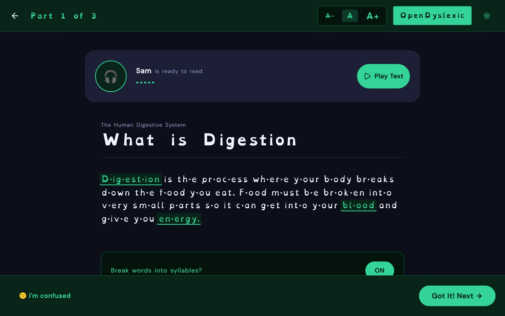 | 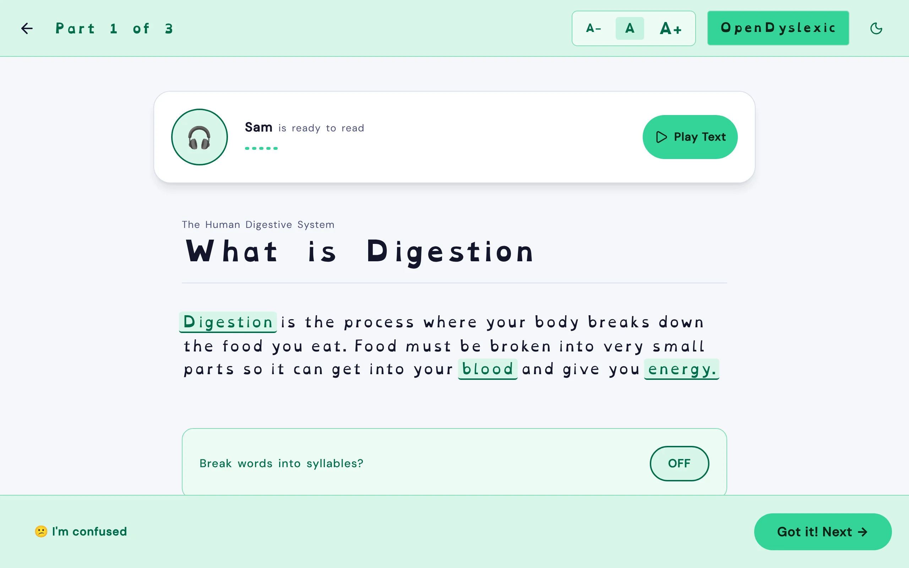 |

| "I'm confused" overlay                                                                   | Teacher portal output                                                                     |
| ---------------------------------------------------------------------------------------- | ----------------------------------------------------------------------------------------- |
| 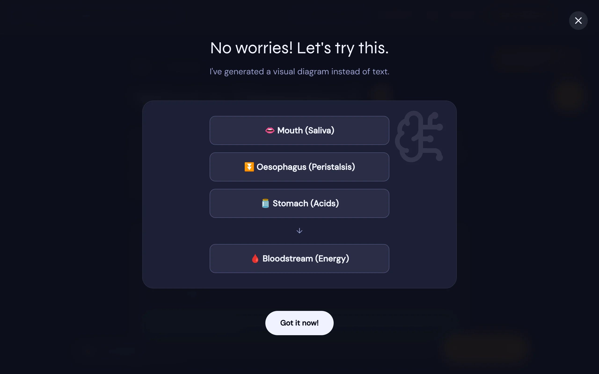 | 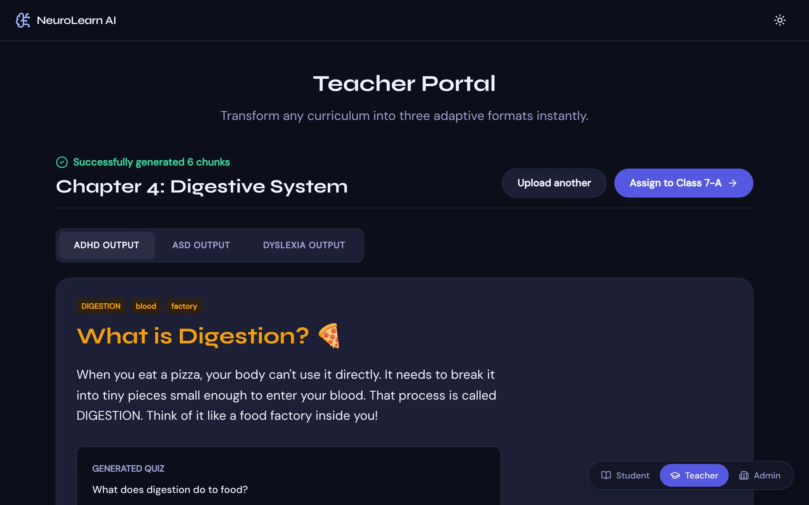 |

| Teacher portal upload                                                                     | Not-found page                                                |
| ----------------------------------------------------------------------------------------- | ------------------------------------------------------------- |
| 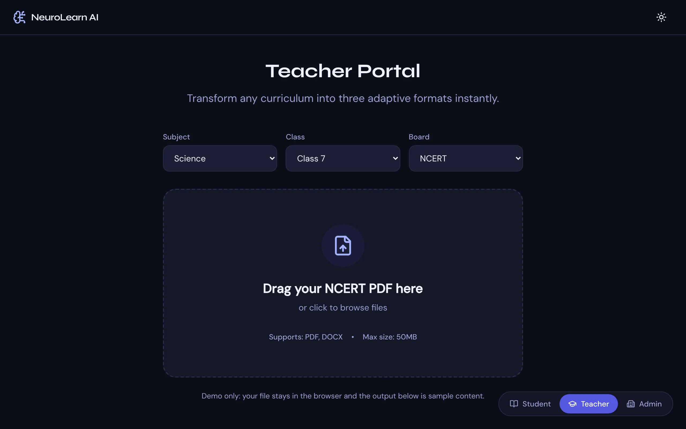 | 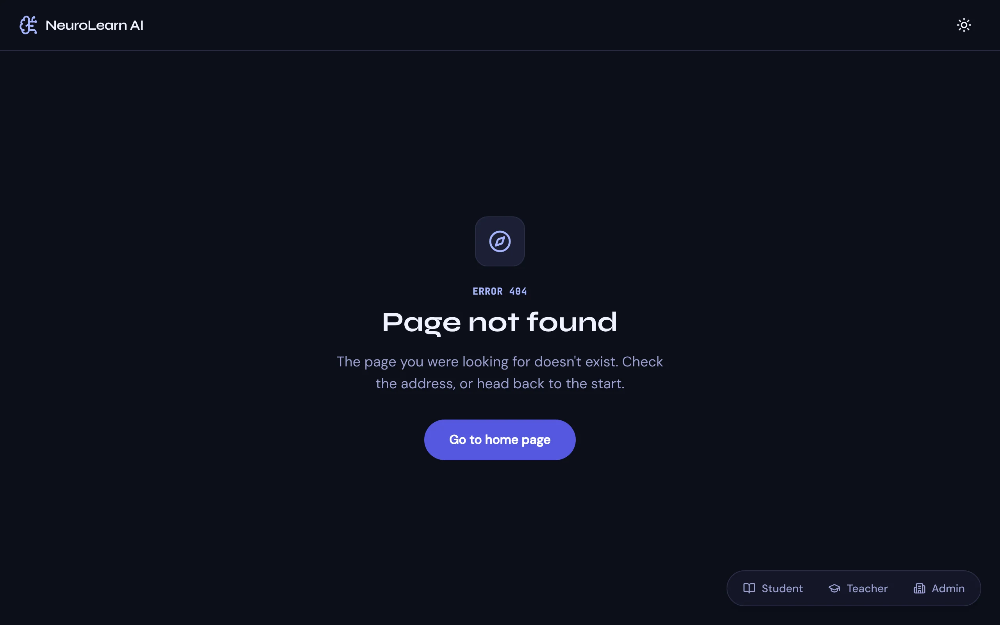 |

<details>
<summary><strong>District admin dashboard (full page)</strong></summary>

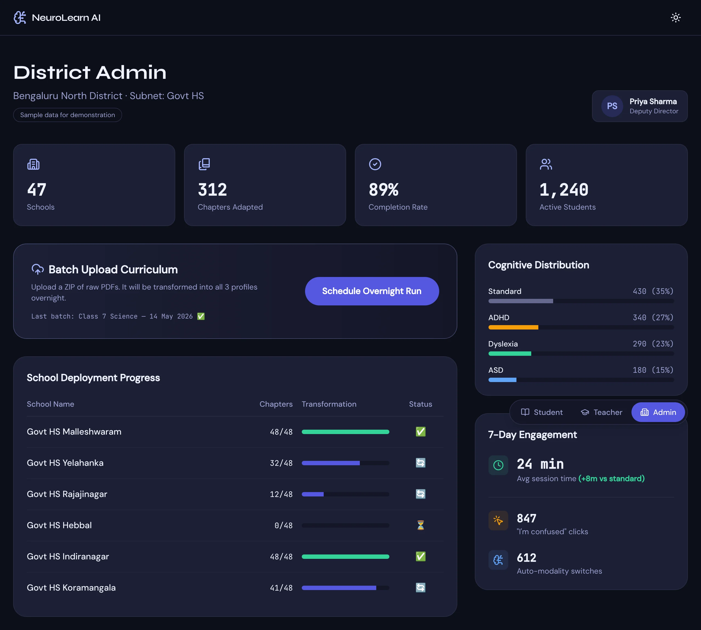

</details>

<details>
<summary><strong>Landing page in the light theme</strong></summary>

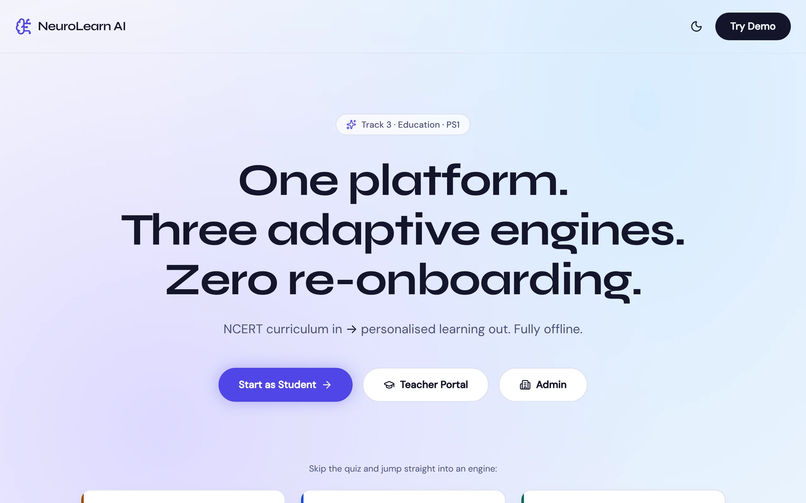

</details>

**On a phone (390 px wide):**

<p>
  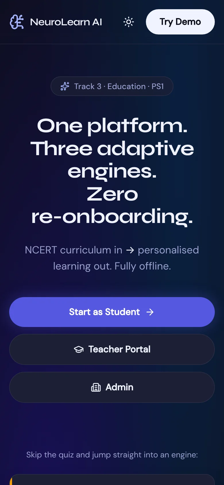
  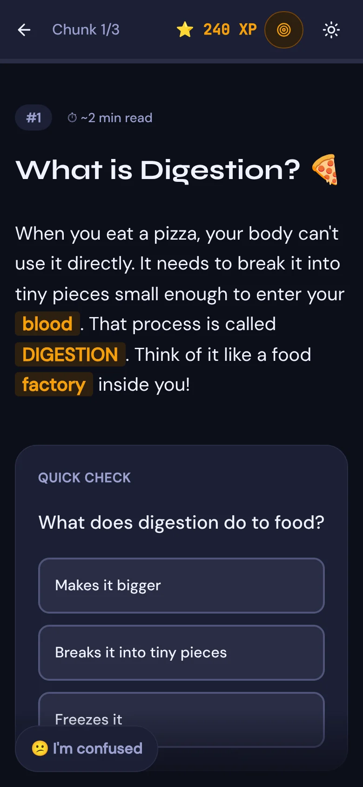
  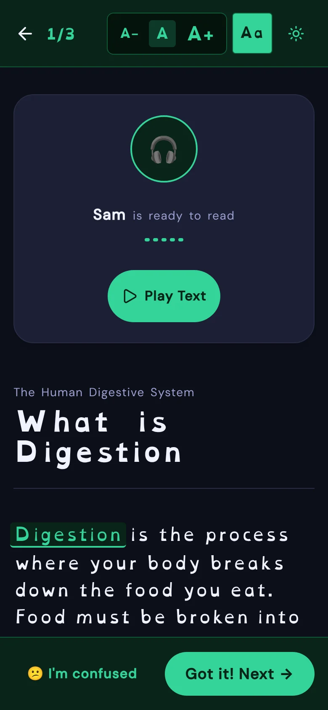
</p>

## Features

### Student

- **Onboarding quiz** (`/onboarding`): five questions about attention span, learning modality, sensory needs, layout preference and motivation, with a progress bar and a Back button. A rule-based recommender (`src/utils/profileUtils.ts`) turns the answers into a learning mode and a three-number profile vector, which is saved in `localStorage`.
- **Instant demo profiles:** each engine card on the landing page loads a preset student (Arjun for ADHD, Priya for ASD, Rahul for dyslexia) and skips the quiz.
- **Student dashboard** (`/student`): the recommended mode, a "continue where you left off" card and the chapter list with per-mode reading times.
- **ADHD engine:** short chunks with highlighted key terms, a quick-check question per chunk, XP and an answer streak, confetti on correct answers (skipped when reduced motion is preferred), a live countdown and a distraction-free **Focus Mode** (leave with <kbd>Esc</kbd>).
- **ASD engine:** literal language, a fixed layout with no motion, a companion panel ("Nila"), a visual schedule of done, current and upcoming sections, a "what's next" preview, an explicit confirmation before moving on, and **Quiet mode**, which hides the side panels.
- **Dyslexia engine:** OpenDyslexic font toggle, three text sizes, optional syllable splitting, key terms you can tap to hear spoken, and **read-aloud with word-by-word highlighting** through the browser's Web Speech API. Highlighting follows the speech engine's word-boundary events and falls back to timing estimates when the engine doesn't send them. Without speech support, the Play button is disabled with an explanation.
- **"I'm confused" button** in every engine: opens an accessible dialog that simulates switching the explanation to a step-by-step visual diagram.

### Teacher (`/teacher`)

- Labelled subject, class and board fields, plus a drop zone that accepts a click (real file picker) or drag-and-drop.
- The browser checks the file type (PDF or DOCX) and size (50 MB maximum) and shows a friendly error otherwise. **The file is never uploaded.**
- A simulated five-step pipeline with live progress, then the ADHD, ASD and dyslexia versions of the sample chapter in keyboard-navigable tabs.

### District admin (`/admin`)

- Headline stats, school-by-school rollout progress, how students split across profiles, 7-day engagement figures and a simulated "Schedule Overnight Run" action. Clearly labelled as sample data.

### Across the app

- **Light and dark themes**, following the operating-system setting until the user picks one with the sun/moon toggle (remembered per device, applied before first paint).
- **One design system:** semantic colour tokens, shared button, card and field styles, and consistent spacing and type. All text colours meet WCAG AA contrast in both themes.
- **Responsive** from 375 px phones to wide desktops, with no horizontal scrolling and 44 px touch targets for icon buttons.
- **Clear states everywhere:** a loading spinner for lazy-loaded pages, an error boundary with a reload button, a 404 page, a "lesson not found" page and a "coming soon" page for chapters without demo content.
- **Fast first load:** each route is code-split, and fonts (DM Sans, Syne, JetBrains Mono, OpenDyslexic) are self-hosted through Fontsource, so the app makes no third-party requests.
- Per-page titles, a meta description, Open Graph and Twitter card tags, and an SVG favicon.

## Tech stack

| Area          | Tools                                                                                    |
| ------------- | ---------------------------------------------------------------------------------------- |
| UI framework  | [React 19](https://react.dev), [React Router 7](https://reactrouter.com)                 |
| Language      | TypeScript 5.8 in strict mode                                                            |
| Styling       | [Tailwind CSS 4](https://tailwindcss.com) (Vite plugin) with CSS custom-property tokens  |
| Motion        | [Framer Motion](https://motion.dev) (respects `prefers-reduced-motion`), canvas-confetti |
| Icons & fonts | [lucide-react](https://lucide.dev), [Fontsource](https://fontsource.org)                 |
| Build tool    | [Vite 6](https://vite.dev)                                                               |
| Testing       | [Vitest](https://vitest.dev), [Testing Library](https://testing-library.com), jsdom      |
| Code quality  | ESLint 9 (typescript-eslint, react-hooks, jsx-a11y), Prettier, EditorConfig              |
| Browser APIs  | Web Speech API (`speechSynthesis`), `localStorage`, `matchMedia`                         |
| CI            | GitHub Actions (`.github/workflows/ci.yml`)                                              |

## Architecture

The app is a single-page React application. Everything it shows comes from modules in `src/data`; the only persistent state is the student profile and theme choice in `localStorage`.

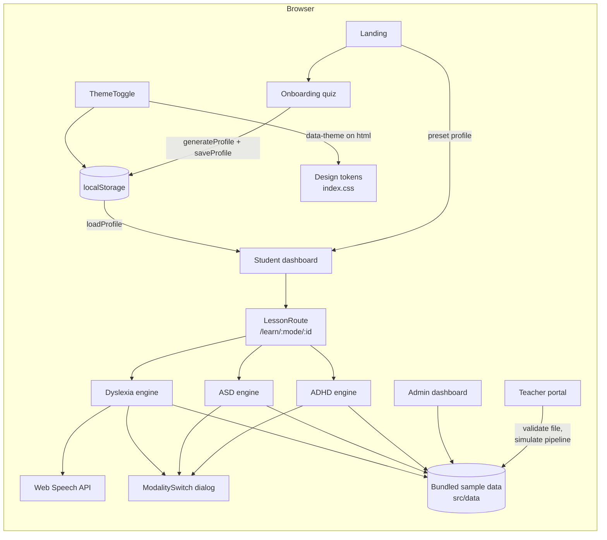

**How the pieces fit together:**

- **`App.tsx`** sets up the router, lazy-loads every page except the landing page and 404, and wraps everything in an error boundary and a `Suspense` loading fallback. It also renders the skip link, scroll reset and floating role switcher.
- **Pages** (`src/pages`) are route components. `LessonRoute` validates `:mode` and `:id` and renders the matching engine, keyed by chapter so a new chapter starts with fresh state.
- **Pure logic** (`src/utils`, `src/theme`) has no React dependency and is unit-tested: profile recommendation and storage, key-term and syllable splitting, speech-highlight timing, upload validation, navigation rules and theme resolution.
- **Hooks** (`src/hooks`) cover the countdown timer, temporary `<body>` classes and document titles.
- **Theming** works by setting `data-theme="light"` or `"dark"` on `<html>`. The CSS tokens in `src/index.css` switch values, and Tailwind utilities such as `bg-card` and `text-muted` read those tokens.

### The recommendation rules

`recommendMode()` applies these rules in order, so later rules win:

1. Default to the calm, predictable **ASD** engine.
2. Attention span of 10 minutes or less **and** motivated by progress bars and rewards → **ADHD**.
3. Learns best by listening **or** prefers a minimal layout → **Dyslexia** (audio-first).
4. Minimal layout **and** needs total silence → back to **ASD**.

This is a demonstration heuristic, not a clinical or diagnostic tool.

## Project structure

```
.
├── .github/workflows/ci.yml        # CI: format check, lint, type-check, tests, build, audit
├── docs/screenshots/               # README screenshots captured from the running app
├── index.html                      # metadata, Open Graph tags, favicon, pre-paint theme script
├── public/favicon.svg
├── src/
│   ├── main.tsx                    # entry point: fonts, global CSS, React root
│   ├── App.tsx                     # routes, lazy loading, error boundary, skip link
│   ├── index.css                   # design tokens (light + dark), base and component styles
│   ├── types.ts                    # shared domain types (LearningMode, StudentProfile, …)
│   ├── components/
│   │   ├── layout/
│   │   │   ├── AppHeader.tsx       # logo + theme toggle bar for dashboard/teacher/admin
│   │   │   ├── ErrorBoundary.tsx   # catches render and chunk-load errors
│   │   │   ├── PageLoader.tsx      # Suspense fallback spinner
│   │   │   ├── RoleSwitcher.tsx    # floating Student / Teacher / Admin switch
│   │   │   ├── ScrollToTop.tsx     # resets scroll on route change
│   │   │   ├── SkipLink.tsx        # "Skip to main content"
│   │   │   └── StatusScreen.tsx    # shared 404 / not-found / coming-soon layout
│   │   ├── learning/
│   │   │   └── ModalitySwitch.tsx  # "I'm confused" dialog
│   │   └── ui/
│   │       └── ThemeToggle.tsx     # light/dark switch
│   ├── data/                       # sample chapters, lesson chunks, profiles, quiz, district data
│   ├── hooks/                      # useCountdown, useBodyClass, useDocumentTitle
│   ├── pages/                      # route components and their integration tests
│   ├── test/                       # Vitest setup and render-with-router helper
│   ├── theme/                      # theme preference storage, resolution and hook
│   └── utils/                      # pure logic with unit tests
├── eslint.config.js
├── vite.config.ts                  # Vite and Vitest configuration
├── tsconfig.json
└── package.json
```

## Getting started

### Prerequisites

- **Node.js 20.19 or newer.** CI uses the version in `.nvmrc` (currently 22). With nvm: `nvm use`.
- **npm** (bundled with Node.js).
- A modern browser. For read-aloud, use Chrome or Edge, which ship speech voices on most systems.

### Installation

```bash
# 1. Clone the repository
git clone https://github.com/jeevithg090/NueroAI_Demo.git
cd NueroAI_Demo

# 2. Use the pinned Node version (optional, needs nvm)
nvm use

# 3. Install exact dependency versions from package-lock.json
npm ci

# 4. Start the dev server
npm run dev
```

Open <http://localhost:3000>. The dev server also listens on your local network (`--host=0.0.0.0`), so you can open it from a phone on the same Wi-Fi using your computer's IP address.

### Production build

```bash
npm run build     # type-checks, then builds static files into dist/
npm run preview   # serves dist/ at http://localhost:4173
```

## Configuration

The app needs **no environment variables, API keys or secrets**. There is one optional development setting:

| Variable      | Required | Default | Description                                                                                                   |
| ------------- | -------- | ------- | ------------------------------------------------------------------------------------------------------------- |
| `DISABLE_HMR` | No       | unset   | Set to `true` to turn off hot module reloading and file watching in `npm run dev` (useful in hosted editors). |

Example: `DISABLE_HMR=true npm run dev`.

Browser storage keys the app uses:

| Key                  | Contents                                        | Cleared by                                    |
| -------------------- | ----------------------------------------------- | --------------------------------------------- |
| `neurolearn_profile` | The student profile from onboarding or a preset | Retaking the quiz overwrites it               |
| `neurolearn_theme`   | `light` or `dark` once the user picks a theme   | Clearing site data (falls back to OS setting) |

## Usage walkthrough

1. **Start on the landing page** (`/`). Choose **Start as Student** to take the quiz, or click an engine card (for example **ADHD Engine**) to jump in with a preset student.
2. **Take the quiz.** Answer five questions; each answer advances automatically, and **Back** returns to the previous question. A short "Analysing your profile…" screen shows the profile vector, then you land on the dashboard.
3. **Open a lesson.** On the dashboard, **Continue in ADHD** (or your mode) opens _The Human Digestive System_. The other chapters show a "coming soon" page because the demo ships adapted content for one chapter.
4. **Try each engine** by editing the URL:
   - `/learn/adhd/ch4-digestive`: answer the quick check to earn XP, then press **Got it! Next**. Try **Focus Mode** and leave with <kbd>Esc</kbd>.
   - `/learn/asd/ch4-digestive`: pick an answer to unlock **I understand. Next**, and toggle **Quiet mode**.
   - `/learn/dyslexia/ch4-digestive`: press **Play Text** to hear the passage with word highlighting, change the text size, switch syllables on, or tap a highlighted key term.
5. Press **I'm confused** (or **I don't understand**) in any engine to see the visual-explanation overlay. Close it with **Got it now!**, the close button or <kbd>Esc</kbd>.
6. **Switch roles** with the floating Student / Teacher / Admin control.
7. **Teacher portal:** choose a PDF or DOCX (any small file with that extension works; it never leaves the browser), watch the pipeline, then browse the three outputs with the tabs or the arrow keys.
8. **Admin dashboard:** review the sample district data and press **Schedule Overnight Run**.
9. **Change the theme** at any time with the sun/moon button in the header.

To reset the demo, clear the site's local storage in your browser's developer tools, or retake the quiz.

## Scripts

| Command                | What it does                                                       |
| ---------------------- | ------------------------------------------------------------------ |
| `npm run dev`          | Start the Vite dev server on port 3000 (all network interfaces)    |
| `npm run build`        | Type-check with `tsc`, then build a production bundle into `dist/` |
| `npm run preview`      | Serve the built `dist/` folder on port 4173                        |
| `npm test`             | Run the whole test suite once                                      |
| `npm run test:watch`   | Run tests in watch mode                                            |
| `npm run typecheck`    | `tsc --noEmit`                                                     |
| `npm run lint`         | ESLint across the project                                          |
| `npm run format`       | Format every file with Prettier                                    |
| `npm run format:check` | Check formatting without writing (what CI runs)                    |
| `npm run clean`        | Delete `dist/` and `coverage/`                                     |

## Routes

There is no backend API. These are the client-side routes:

| Path               | Page              | Notes                                                                               |
| ------------------ | ----------------- | ----------------------------------------------------------------------------------- |
| `/`                | Landing           | Entry point; engine cards load preset profiles                                      |
| `/onboarding`      | Onboarding quiz   | Saves a profile, then redirects to `/student`                                       |
| `/student`         | Student dashboard | Redirects to `/onboarding` when no valid profile is stored                          |
| `/learn/:mode/:id` | Lesson engine     | `mode` is `adhd`, `asd` or `dyslexia`; `id` is a chapter id such as `ch4-digestive` |
| `/teacher`         | Teacher portal    | Client-side file validation and simulated pipeline                                  |
| `/admin`           | District admin    | Sample data only                                                                    |
| any other path     | 404 page          | Links back to the home page                                                         |

Chapter ids: `ch4-digestive` (has demo content), `ch6-fractions`, `ch2-forests`, `ch1-ancient` (show the "coming soon" page).

## Design system and theming

All colours are defined once in `src/index.css` as CSS custom properties, with a dark set (default) and a light set. Tailwind utilities map to them through `@theme inline`, so components only use semantic names:

| Token                                                       | Used for                                                                                      |
| ----------------------------------------------------------- | --------------------------------------------------------------------------------------------- |
| `canvas`, `surface`, `card`, `raised`                       | Page background → panels → cards → controls                                                   |
| `line`, `line-strong`                                       | Borders and dividers                                                                          |
| `fg`, `muted`, `subtle`                                     | Primary, secondary and tertiary text                                                          |
| `accent`, `accent-solid`                                    | Brand indigo for text/focus rings, and filled buttons                                         |
| `adhd`, `asd`, `dys` (+ `-solid`, `-ink`, `-soft`, `-line`) | Per-engine colours for text, filled buttons, the text on them, tinted backgrounds and borders |
| `danger`, `success` (+ `-soft`)                             | Wrong and right answers, errors                                                               |

Shared component classes keep controls consistent: `.btn` with `.btn-primary`, `.btn-secondary`, `.btn-ghost`, `.btn-inverse` and `.btn-lg`; `.icon-btn` (44 px square); `.card`; `.field` for inputs and selects; `.eyebrow` for small uppercase labels.

To add a colour, define it in both theme blocks in `index.css`, map it in `@theme inline`, and check its contrast against the backgrounds it will sit on.

## Accessibility

- Semantic landmarks (`header`, `nav`, `main`, `aside`), one `h1` per page and a logical heading order.
- A **Skip to main content** link is the first focusable element on every page.
- Every control has a visible label or an accessible name; toggles expose `aria-pressed` or `role="switch"`; progress bars expose their values.
- Teacher output tabs follow the WAI-ARIA tabs pattern (arrow keys, <kbd>Home</kbd>, <kbd>End</kbd>).
- The "I'm confused" dialog moves focus into itself, closes with <kbd>Esc</kbd> and returns focus afterwards. Focus Mode also exits with <kbd>Esc</kbd>.
- Visible focus rings on all interactive elements, and WCAG AA colour contrast in both themes.
- `prefers-reduced-motion` turns off animations and confetti; `prefers-color-scheme` sets the initial theme.
- The ESLint config includes `eslint-plugin-jsx-a11y`.

## Testing

```bash
npm test             # run once
npm run test:watch   # re-run on save
```

The suite has **73 tests in 15 files**, run with Vitest and Testing Library in jsdom:

| Area              | What's covered                                                                                                                                                                                                                                                       |
| ----------------- | -------------------------------------------------------------------------------------------------------------------------------------------------------------------------------------------------------------------------------------------------------------------- |
| Profile logic     | Recommendation rules, profile generation, storage, corrupt or missing data                                                                                                                                                                                           |
| Text helpers      | Key-term splitting with regex escaping, syllable splitting                                                                                                                                                                                                           |
| Read-aloud        | Word offsets, boundary-event highlighting and the timed fallback (with a mocked `speechSynthesis`)                                                                                                                                                                   |
| Upload validation | Accepted types, empty files, the 50 MB limit                                                                                                                                                                                                                         |
| Hooks             | Countdown timer                                                                                                                                                                                                                                                      |
| Theme             | Preference storage, OS fallback, applying the theme, the toggle button                                                                                                                                                                                               |
| Navigation        | When the role switcher shows, skip link focus                                                                                                                                                                                                                        |
| Integration flows | Routing and fallbacks, the full onboarding run and double-click regression, ADHD XP/streak/answer locking, the ASD confirmation gate and quiet mode, dyslexia font/syllable/size controls and the no-speech state, the teacher pipeline including tabs and its reset |

The UI was also checked manually in headless Chromium (Playwright) at 375, 768 and 1280 px in both themes: no console errors, no horizontal scrolling.

## Linting and formatting

```bash
npm run lint           # ESLint (typescript-eslint, react-hooks, jsx-a11y, react-refresh)
npm run typecheck      # TypeScript strict mode
npm run format:check   # Prettier check (npm run format to fix)
```

Formatting rules live in `.prettierrc.json` and `.editorconfig`. CI runs all three, plus the tests, the build and `npm audit --omit=dev --audit-level=high`, on every pull request and on pushes to `main`.

## Deployment

`npm run build` produces a fully static site in `dist/`. Any static host can serve it: Netlify, Vercel, Cloudflare Pages, GitHub Pages, S3 with CloudFront, nginx and so on. The repository doesn't include host-specific config, so add the one you need.

Because the app uses client-side routing (`BrowserRouter`), the host must **send unknown paths to `/index.html`**, or refreshing a page such as `/teacher` returns the host's 404:

- **Netlify:** create `public/_redirects` containing `/* /index.html 200`.
- **Vercel:** add `vercel.json` with `{ "rewrites": [{ "source": "/(.*)", "destination": "/index.html" }] }`.
- **Cloudflare Pages:** single-page-app routing works by default when there is no `404.html`.
- **nginx:**
  ```nginx
  location / {
    try_files $uri /index.html;
  }
  ```
- **GitHub Pages:** it has no rewrite rules; the common workaround is copying `index.html` to `404.html` after building. If you serve from a sub-path, also set Vite's `base` option and React Router's `basename`.

Built assets in `dist/assets/` have content hashes in their names, so they can be cached for a long time; keep `index.html` uncached.

## Troubleshooting and FAQ

**`npm ci` fails or warns about the engine version.** Check `node -v`; the project needs Node 20.19+. Run `nvm use` to switch to the version in `.nvmrc`.

**The dev server isn't on port 3000.** If 3000 is busy, Vite picks the next free port and prints it in the terminal (for example `http://localhost:3001`).

**Refreshing a page on my deployed site gives a 404.** Your host isn't rewriting routes to `index.html`. See [Deployment](#deployment).

**The Play Text button is disabled.** Your browser doesn't expose the Web Speech API. Try Chrome or Edge. Firefox on Linux often has no voices installed.

**Read-aloud plays but highlighting drifts.** Some voices don't send word-boundary events; the app then estimates timing, which can drift on long passages.

**The dashboard keeps sending me to the quiz.** No valid profile is stored (for example, storage is blocked in private mode, or the data was cleared). Take the quiz or click an engine card on the landing page.

**Only one chapter opens.** That's expected: only _The Human Digestive System_ has adapted demo content.

**I uploaded a file in the Teacher portal; where did it go?** Nowhere. Files are checked in the browser and never sent anywhere. The output shown is bundled sample content.

**How do I reset everything?** Clear the site's local storage in your browser's developer tools (Application → Local Storage).

**Is the onboarding quiz a diagnosis?** No. It's a short heuristic for the demo and must not be used to label or diagnose anyone.

## Known limitations

- Lesson content, the transformation pipeline, district metrics and the landing-page figures (students supported, TTS latency, languages, inference cost) are **sample data, simulations or design goals**, not measured results.
- Adapted content exists for **one chapter** only.
- The recommender is a hand-written rule set, not a trained or validated model.
- There are no accounts and no server; progress isn't saved beyond the profile and theme in `localStorage`.
- Read-aloud quality depends on the voices installed in the user's browser and operating system. It isn't translated into other languages.
- The interface is in English only.

## Roadmap ideas

- A real backend for curriculum ingestion (PDF/DOCX parsing) and generation of the three adapted formats.
- Adapted content for more chapters and subjects, and Indian-language support (for example via Bhashini).
- Accounts, saved progress and teacher class management.
- Offline support (service worker) for low-connectivity schools.
- Automated accessibility checks (for example axe) and visual regression tests in CI.
- User research with students, teachers and specialists to validate the engines and the recommendation rules.

## Contributing

1. Fork the repository and create a branch from `main`.
2. `npm ci`, then make your change. Use the design tokens and shared classes in `src/index.css` instead of hard-coded colours.
3. Add or update tests next to the code you change (`*.test.ts` / `*.test.tsx`).
4. Before opening a pull request, run:
   ```bash
   npm run format && npm run lint && npm run typecheck && npm test && npm run build
   ```
5. Write commit messages in the [Conventional Commits](https://www.conventionalcommits.org) style (`feat:`, `fix:`, `docs:` …) and describe how you tested the change in the pull request.

## License

The repository doesn't include a license yet, which means all rights are reserved by default. If you plan to accept contributions or let others reuse the code, consider adding a standard open-source license such as **MIT** or **Apache-2.0**.

Third-party fonts are used under their own licenses (SIL Open Font License for DM Sans, Syne, JetBrains Mono and OpenDyslexic). The sample lesson text in `src/data` covers an NCERT Class 7 Science topic and is simplified for the demo.
