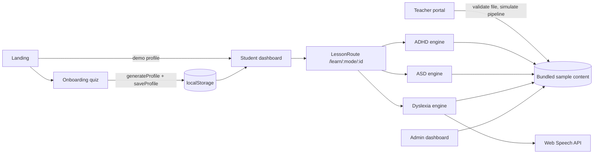

# NeuroLearn AI

**One curriculum, three adaptive learning engines.** NeuroLearn AI is an interactive front-end prototype of a platform that takes a school chapter (an NCERT Class 7 Science chapter in the demo) and presents it in formats designed for students with **ADHD**, **autism (ASD)** and **dyslexia**. It also shows the teacher and district-admin sides of the same product.

The prototype is built so that hackathon judges and other stakeholders can walk through the full **student → teacher → admin** journey in a browser. All content and metrics are bundled sample data. No backend, no AI model calls, and no network requests happen at runtime.

## Features

### Student

- **Onboarding quiz:** five questions about attention span, learning modality, sensory needs, layout preference and motivation. A rule-based recommender (`src/utils/profileUtils.ts`) maps the answers to a learning mode and a 3-dimensional profile vector, which is saved in `localStorage`.
- **Instant demo profiles:** each engine card on the landing page loads a preset student (Arjun, Priya or Rahul) and skips the quiz.
- **ADHD engine (`/learn/adhd/:chapter`):** short "chunks" with highlighted key terms, a quick-check question after each chunk, XP and an answer streak, confetti for correct answers (skipped when the user prefers reduced motion), a countdown timer and a distraction-free **Focus Mode** (exit with <kbd>Esc</kbd>).
- **ASD engine (`/learn/asd/:chapter`):** literal language, a fixed layout with no motion, a visual schedule showing done, current and upcoming sections, a "what's next" preview, an explicit confirmation step before moving on, and a **Quiet mode** that hides the side panels.
- **Dyslexia engine (`/learn/dyslexia/:chapter`):** OpenDyslexic font toggle, three text sizes, an optional syllable-splitting view, key terms you can tap to hear spoken, and **read-aloud with word-by-word highlighting** through the browser's Web Speech API. Highlighting follows the speech engine's word-boundary events and falls back to timing estimates when the engine doesn't send them.
- **"I'm confused" button:** opens an overlay that simulates switching the explanation to a visual, step-by-step diagram.

### Teacher (`/teacher`)

- Pick a PDF or DOCX file, or drag one in. The browser checks the file type and the 50 MB size limit. The file is **never uploaded**.
- A simulated five-step transformation pipeline runs, then the ADHD, ASD and dyslexia versions of the sample chapter appear in tabs.

### District admin (`/admin`)

- A district dashboard built on sample data: headline stats, school-by-school rollout progress, how students split across learning profiles, 7-day engagement figures and a simulated "schedule overnight batch" action.

### Cross-cutting

- Routes are code-split and lazy-loaded, with a loading state and an error boundary.
- Unknown routes, unknown chapters and chapters that have no demo content yet each get a clear page explaining what happened.
- Accessibility basics: semantic landmarks and headings, labelled controls, `aria-pressed`/`aria-selected` states, an accessible dialog (focus handling and <kbd>Esc</kbd> to close), visible focus rings and `prefers-reduced-motion` support.
- Responsive from phone to desktop. Each page sets its own `document.title`.
- Fonts (DM Sans, Syne, JetBrains Mono, OpenDyslexic) are self-hosted through Fontsource, so the built app makes no third-party requests.

## Tech stack

| Area    | Tools                                                           |
| ------- | --------------------------------------------------------------- |
| UI      | React 19, TypeScript (strict), React Router 7                   |
| Styling | Tailwind CSS 4 (Vite plugin), Framer Motion, lucide-react icons |
| Build   | Vite 6                                                          |
| Quality | ESLint 9 (typescript-eslint, react-hooks, jsx-a11y), Prettier   |
| Testing | Vitest, Testing Library, jsdom                                  |
| Browser | Web Speech API (`speechSynthesis`), `localStorage`              |
| CI      | GitHub Actions                                                  |

## Architecture



- **Pages** (`src/pages`) are route-level components. `LessonRoute` checks the `:mode` and `:id` URL parameters and renders the matching engine. It is keyed by chapter, so opening a different chapter starts with fresh state.
- **Pure logic** lives in `src/utils`: profile recommendation and storage, key-term splitting, syllable splitting, speech-highlight timing and upload validation. Each module has unit tests.
- **Sample content** lives in `src/data`. Only _The Human Digestive System_ has adapted lesson content. The other chapters show a "not in the demo yet" page.
- **Shared types** live in `src/types.ts`.

## Getting started

**Prerequisites:** Node.js 20.19+ (CI uses the version in `.nvmrc`, currently 22) and npm.

```bash
npm ci          # install exact dependency versions from package-lock.json
npm run dev     # start the dev server at http://localhost:3000
```

### Environment variables

The app needs **no environment variables or API keys**. One optional development setting exists:

| Variable      | Default | Purpose                                                                         |
| ------------- | ------- | ------------------------------------------------------------------------------- |
| `DISABLE_HMR` | unset   | Set to `true` to turn off hot module reloading and file watching in `vite dev`. |

### Scripts

| Command              | What it does                                            |
| -------------------- | ------------------------------------------------------- |
| `npm run dev`        | Vite dev server on port 3000                            |
| `npm run build`      | Type-check, then build a production bundle into `dist/` |
| `npm run preview`    | Serve the built `dist/` locally on port 4173            |
| `npm test`           | Run the test suite once                                 |
| `npm run test:watch` | Run tests in watch mode                                 |
| `npm run lint`       | ESLint                                                  |
| `npm run typecheck`  | `tsc --noEmit`                                          |
| `npm run format`     | Format with Prettier (`format:check` to verify)         |

## Deployment

`npm run build` writes a fully static site to `dist/`, which any static host can serve (Netlify, Vercel, Cloudflare Pages, GitHub Pages, S3 with CloudFront, nginx, and so on).

The app uses client-side routing (`BrowserRouter`), so the host must **rewrite unknown paths to `/index.html`**. Otherwise refreshing a page such as `/teacher` returns a 404. For example:

- **Netlify:** add `public/_redirects` containing `/* /index.html 200`.
- **Vercel:** add a `vercel.json` with `{ "rewrites": [{ "source": "/(.*)", "destination": "/index.html" }] }`.
- **nginx:** `try_files $uri /index.html;`

Read-aloud depends on the speech voices built into the user's browser and operating system. Chrome and Edge have the widest support. When speech isn't available, the Play button is disabled and a short message explains why.

## Project structure

```
.
├── .github/workflows/ci.yml   # format, lint, type-check, test, build, audit
├── index.html                 # page metadata and favicon
├── public/favicon.svg
├── src/
│   ├── main.tsx               # entry point: fonts, global CSS, React root
│   ├── App.tsx                # routes, lazy loading, error boundary
│   ├── index.css              # Tailwind theme tokens and global styles
│   ├── types.ts               # shared domain types
│   ├── components/
│   │   ├── layout/            # RoleSwitcher, StatusScreen, PageLoader, ErrorBoundary
│   │   └── learning/          # ModalitySwitch ("I'm confused" overlay)
│   ├── data/                  # bundled sample chapters, profiles, quiz and district data
│   ├── hooks/                 # useCountdown, useBodyClass, useDocumentTitle
│   ├── pages/                 # route components and their integration tests
│   ├── test/                  # test setup and render helpers
│   └── utils/                 # pure logic with unit tests
├── eslint.config.js
├── vite.config.ts             # Vite and Vitest configuration
└── tsconfig.json
```

## Prototype scope and limitations

These are deliberate simplifications of the prototype:

- Lesson content, the transformation pipeline, district metrics and landing-page figures are **sample data or simulations**. Nothing is generated by a model at runtime.
- The learning-mode recommendation is a short, hand-written set of rules for demonstration. It is **not a clinical or diagnostic tool**.
- Profiles are stored only in the browser's `localStorage`. There are no accounts and no server.
